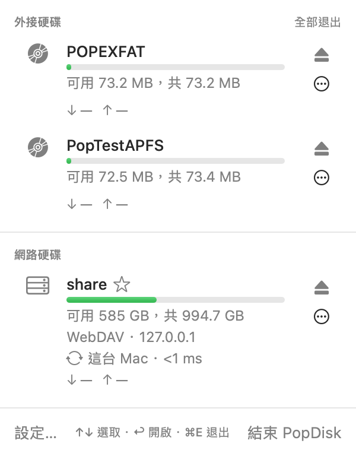
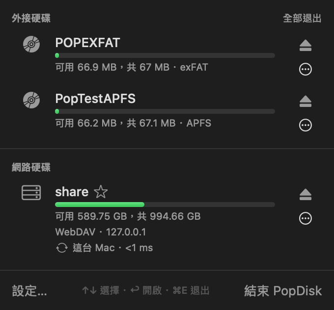
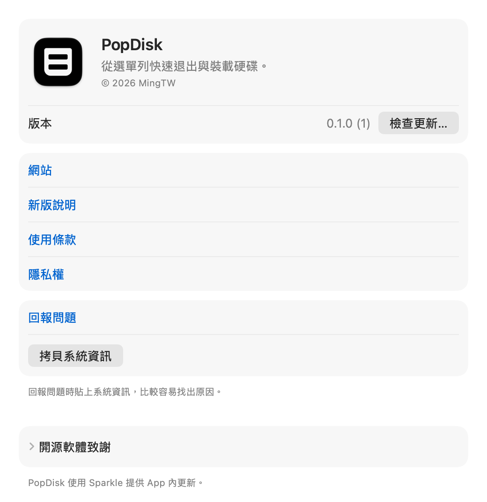
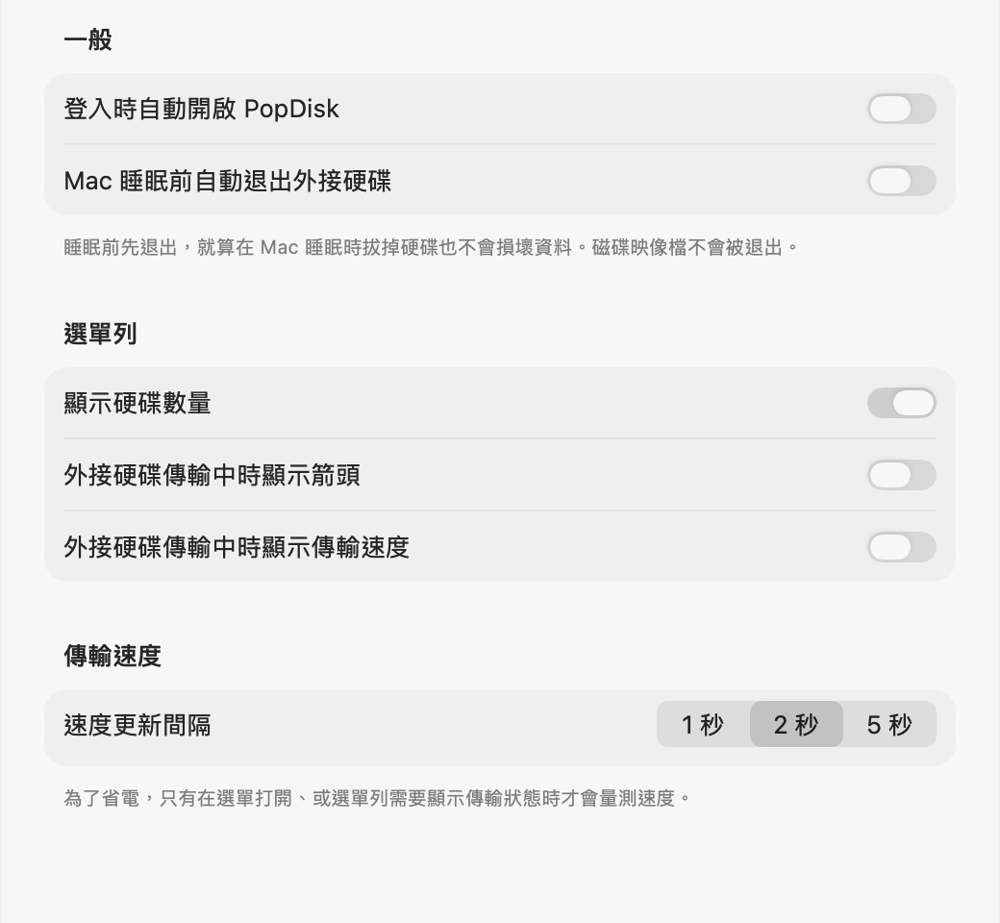

# PopDisk

PopDisk 是一個放在 Mac 螢幕上方選單列的小工具，幫你**一鍵退出、連接外接硬碟和網路硬碟**，還能看到每顆硬碟的連線速度和目前傳輸的快慢。

> **目前是測試版（0.1.0），還不是穩定版本。** 功能都已完成，但還在實際使用中測試，可能還有問題，遇到時歡迎[回報](https://github.com/chiehming113/PopDisk/issues/new/choose)。目前主要在 macOS 27 上測試，macOS 15、26 還沒有實際測過。

  
  

## 能做什麼

- **快速退出硬碟**：點一下就能安全退出隨身碟、外接硬碟、SD 卡，也可以一次全部退出。
- **知道誰在「佔用」硬碟**：退出失敗時，直接告訴你是哪個 App 還開著硬碟裡的檔案，可以一鍵關掉後再試一次。
- **退出完會告訴你「可以拔了」**，不用再猜。
- **連接網路硬碟**：把家裡或公司的 NAS、共用資料夾加入「常用清單」，之後點一下就能連上，密碼會安全地存在鑰匙圈裡。
- **自動重新連線**：Mac 睡醒或網路斷掉又恢復時，網路硬碟會自動接回來；也可以設定開機後自動連上。
- **看連線速度**：顯示硬碟是用多快的方式連接（例如 USB 10Gbps、Thunderbolt、Wi‑Fi），如果接錯插孔或用到慢速線材，會提醒你「速度受限」。
- **看傳輸速度**：複製檔案時可以看到目前每秒傳了多少。
- **空間快滿時提醒你**：剩餘空間低於設定的比例（預設 10%）時跳出通知。
- **睡眠前自動退出**：Mac 要睡眠時先把外接硬碟退好，就算睡著時拔掉也不會傷到資料。
- **全域快捷鍵**：不用打開選單，就算正在用其他 App，也能一鍵退出全部硬碟或打開 PopDisk。
- **個人化**：幫硬碟取暱稱、換圖示、調整順序。
- **中文／英文介面**，依照系統語言自動切換。

## 系統需求

- macOS 15（Sequoia）或更新版本

## 安裝

1. 到 [Releases](https://github.com/chiehming113/PopDisk/releases) 下載最新版的 `PopDisk-版本.zip`。
2. 打開下載的 zip，把裡面的 `PopDisk` 拖到「應用程式」資料夾。
3. 打開 PopDisk。它已經通過 Apple 的安全檢查（公證），可以直接打開。打開後，PopDisk 會出現在螢幕右上角的選單列（不會出現在 Dock）。
4. 想要每次開機都自動開啟：點 PopDisk 圖示 →「設定…」→「一般」，打開「登入時自動開啟 PopDisk」。

**移除**：點 PopDisk 圖示 →「結束 PopDisk」，再把「應用程式」裡的 PopDisk 丟到垃圾桶。如果有打開「登入時自動開啟」，記得先關掉。

## 更新

PopDisk 每天會自動檢查一次有沒有新版本。有新版時會跳出視窗或通知，選單下方也會出現「安裝…」；按下去會先顯示這次更新了什麼，你按「安裝更新」才會下載安裝，裝好後 PopDisk 會自己重新打開，設定和密碼都會保留。

- 想馬上檢查：「設定… → 關於」，按「檢查更新…」。
- 不想自動檢查：「設定… → 一般」，關掉「自動檢查更新」。

「設定… → 關於」也可以看目前的版本、使用條款與隱私說明，以及回報問題。

## 使用方式

- **退出硬碟**：點選單列的 PopDisk 圖示，按硬碟旁邊的退出按鈕（⏏）。轉圈圈代表正在退出，看到綠色的「可以安全拔除了」就能拔線。接了好幾顆時，可以按「全部退出」。
- **裝載硬碟**：如果硬碟有接上但沒有出現在 Finder（顯示「未裝載」），按「裝載」就能重新打開它。
- **看連線速度**：每顆硬碟下方會寫它用什麼方式、多快的速度連到 Mac，例如「USB 10 Gb/s」「Thunderbolt · PCIe 3.0 ×4」；SD 卡會寫卡的規格與上限，例如「SD · UHS-I 104 MB/s」（卡的實際速度通常比上限慢）。網路硬碟則會寫走的是 Wi‑Fi 還是有線網路、網路速度，以及回應時間（毫秒，越小越快）。
- **看傳輸速度**：拷貝檔案時，硬碟下方會即時顯示讀取和寫入的速度；網路硬碟則顯示下載和上傳的速度。沒有在傳輸時顯示「—」。數字多久更新一次（1、2 或 5 秒）可以在「設定… → 一般」調整；為了省電，只有選單打開、或選單列要顯示傳輸狀態時才會量。
- **選單列圖示**：沒有接任何硬碟時圖示會變淡；接了好幾顆時會顯示數量（網路硬碟也算，從選單中隱藏的不算）；外接硬碟正在傳輸時會出現上下箭頭。在「設定… → 一般」可以關掉數量或箭頭，或改成直接顯示傳輸速度。
- **看剩餘空間**：每顆硬碟下方的長條代表已使用的空間：綠色是還很充足，黃色是超過 8 成，紅色是超過 9 成、快滿了。
- **加入常用網路硬碟**：打開「設定… → 網路硬碟」，按「＋」，填入位址（例如 `smb://my-nas.local/照片`）、使用者名稱和密碼。之後在選單裡按「連線」就能連上。
  - 位址開頭可以是 `smb://`（大部分 NAS、Windows 分享）、`nfs://` 或 `http://`／`https://`（WebDAV）。名稱可以不填，會自動用分享資料夾的名稱。
  - 密碼會存在 Mac 的「鑰匙圈」裡，不會用明碼存放。沒填密碼的話，連線時 macOS 會跳出視窗問你。
  - 已經從 Finder 連上的網路硬碟，在選單裡按名稱旁邊的 ☆，就能直接加入常用。
  - 在「設定… → 網路硬碟」可以拖曳調整順序；在項目上按右鍵（或選取後按「編輯…」）修改，按「－」刪除，刪除時存在鑰匙圈的密碼也會一起刪掉。
- **開機後自動連上**：在「設定… → 一般」打開「登入時自動開啟 PopDisk」，再到常用網路硬碟勾選「PopDisk 啟動時自動連線」。
- **自動重新連線**：Mac 睡醒或網路斷掉又恢復時，原本連著的網路硬碟會自動接回來。你自己按退出的不會被重新連上。不想要這個功能，可以到「設定… → 網路硬碟」關掉。
- **中斷網路硬碟**：按網路硬碟旁邊的 ⏏。
- **在 Finder 打開硬碟**：在選單裡點一下硬碟名稱就會打開。
- **更多動作**：按硬碟右邊的 ⋯（或在硬碟上按右鍵），可以：
  - 在 Finder 或「終端機」中開啟、在 Finder 中顯示（打開上一層並選好這顆硬碟）、拷貝路徑
  - 顯示資訊：看硬碟的型號、序號、檔案系統、位置等詳細資料
  - 取暱稱：例如把「Untitled」改叫「工作備份」，只會改 PopDisk 裡顯示的名字，不會動到硬碟本身
  - 釘選在最上方、從選單中隱藏
- **整理硬碟清單**：在「設定… → 硬碟」可以幫每顆硬碟取暱稱、換圖示、拖曳左邊的 ≡ 調整順序，或把隱藏的硬碟顯示回來。不會再用的硬碟可以按垃圾桶，清除 PopDisk 記住的設定（不會動到硬碟裡的資料）。
- **睡眠前自動退出**：在「設定… → 一般」打開「Mac 睡眠前自動退出外接硬碟」。Mac 要睡眠時會先退出外接硬碟（磁碟映像檔不會），有硬碟退不出來時，醒來後會通知你。
- **用鍵盤操作**：打開選單後，↑↓ 選擇硬碟、↩ 在 Finder 開啟、⌘E 退出選取的硬碟、⇧⌘E 全部退出、⌘I 顯示資訊、esc 取消選取、⌘, 打開設定、⌘Q 結束 PopDisk。

- **設定快捷鍵**：在「設定… → 通知」按「錄製快捷鍵」，然後按下想用的組合（例如 ⌃⌥⌘E）。組合裡要有 ⌘、⌥ 或 ⌃ 其中一個；錄製時按 esc 取消、按 ⌫ 清除，平常也可以按旁邊的 ⓧ 清除。「全部退出」快捷鍵不會退出你在選單中隱藏的硬碟。
- **通知**：在「設定… → 通知」選擇什麼時候要通知你：接上硬碟、退出完成或失敗、空間快滿（外接硬碟和網路硬碟都會檢查，磁碟映像檔不會；提醒的比例可選 5%～20%）。第一次通知時 macOS 會問你要不要允許。
- **打開設定**：點 PopDisk 圖示，按「設定…」。

## 常見問題

**退出時說「磁碟正在使用中」怎麼辦？**
代表有 App 還開著硬碟裡的檔案。PopDisk 會直接列出是哪些 App，旁邊有「結束」按鈕：按下去會關掉那個 App（有沒存的檔案時，App 會先問你要不要儲存），關掉後 PopDisk 會自動再退出一次。
如果是在「終端機」裡打開了硬碟裡的資料夾，會顯示「zsh」，下面註明「在終端機中」，按「結束」只會關掉那一個視窗裡的程式，不會關掉整個終端機。
真的沒辦法時可以選「強制退出…」，但正在使用的 App 可能會遺失沒儲存的內容，正在拷貝的檔案也可能損壞，請小心使用。

**為什麼有時候說「找不到是哪個程式在使用」？**
有些是 macOS 的系統程式在讀取硬碟（例如建立搜尋索引），PopDisk 沒有權限查看它們。通常等幾秒再按「再試一次」就可以了。

**為什麼不在 Mac App Store 上架？**
App Store 上的 App 都必須在 macOS 的「App 沙盒」裡執行：App 只能做一般 App 需要的事，不能查看或操作其他 App。這是很好的安全設計，但會讓 PopDisk 少掉幾個最實用的功能：
- 退出失敗時，**告訴你是哪個 App 在使用硬碟，並直接幫你關掉它**
- **在 Finder 或「終端機」中直接打開硬碟**
- **把插在 Mac 內建讀卡機的 SD 卡重新裝載**（沙盒裡只能請你拔出再插回去）

這些都是 PopDisk 的核心功能，所以 PopDisk 選擇不上架，只在 GitHub 發佈。從 GitHub 下載的版本一樣經過 Apple 的安全檢查（公證）。

**為什麼顯示「連線速度受限」？**
代表硬碟或網路明明可以跑更快，卻被某個環節拖慢了，而且通常是你自己就能改善的：
- **USB 硬碟只跑到 USB 2 的速度**：可能是插在舊的 USB 插孔、經過慢速 Hub，或用了只支援 USB 2 的線（很多充電線都是）。換一個插孔或線材試試。
- **建議改用有線網路**：Mac 同時有有線網路，但連到這台 NAS 時走的是 Wi‑Fi。可以到「系統設定 → 網路」調整服務順序，把有線網路排在前面。
- **有線網路只有 100 Mb/s**：網路線老舊、接觸不良，或交換器比較舊。換一條網路線通常就能解決。

**設定快捷鍵時顯示「已被其他 App 使用」？**
這個組合已經被別的 App 用掉了，換一個組合就好，例如多加 ⇧。如果顯示的是「已被 PopDisk 的另一個快捷鍵使用」，代表 PopDisk 另一個動作已經用了這個組合，兩個動作要用不同的組合。

**沒有收到通知？**
到「系統設定 → 通知 → PopDisk」確認通知是開著的。另外，選單開著的時候，退出結果會直接顯示在選單裡，不會另外跳通知。

**網路硬碟連不上，顯示「連不到伺服器」？**
請確認 NAS 有開機、Mac 和 NAS 在同一個網路，以及位址有沒有打錯。在公司或外面時，可能需要先連上 VPN。

**Mac 問我要不要讓 PopDisk 使用鑰匙圈？**
這是 macOS 保護密碼的機制，PopDisk 要讀取你存的網路硬碟密碼時會詢問。選「永遠允許」之後，同一個版本的 PopDisk 就不會再問。換成另一個來源的 PopDisk（例如從自己編譯的版本換成官方下載的版本）時，Mac 會把它當成不同的 App，再問一次，一樣選「永遠允許」就好。

**網路硬碟的傳輸速度怎麼這麼高（或怎麼一直在跳）？**
網路硬碟顯示的是整個網路連線的流量，同時在用網路的其他 App（例如瀏覽器、串流）也會算進去。

**遇到問題要怎麼回報？**
打開「設定… → 關於」，按「拷貝系統資訊」，再按「回報問題」，在 GitHub 上填寫發生了什麼，並貼上剛剛拷貝的資訊（PopDisk 和 macOS 的版本、Mac 機型，不包含你的硬碟名稱或伺服器位址）。

## 隱私

PopDisk 不會收集或上傳你的任何資料。它只會連到 GitHub 檢查和下載新版本；網路硬碟的密碼只存在你這台 Mac 的鑰匙圈裡。詳見[隱私說明](PRIVACY.zh-Hant.md)（[English](PRIVACY.md)）。

## 授權

PopDisk 可以免費下載使用，但不是開放原始碼軟體。使用前請看[使用條款](LICENSE.zh-Hant.md)（[English](LICENSE)）。

© 2026 MingTW

## 使用的開源軟體

- [Sparkle](https://sparkle-project.org)：App 內更新，MIT 授權。完整授權聲明在「設定… → 關於 → 開源軟體致謝」。
